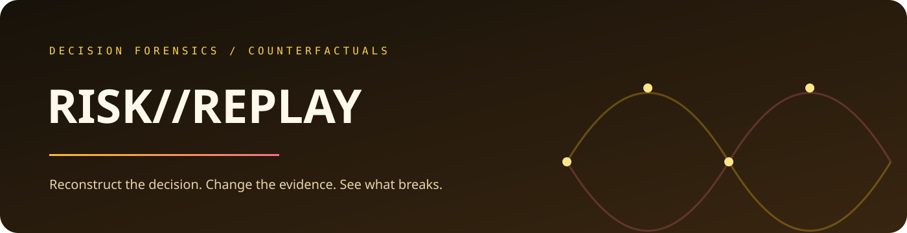

  

  <a href="https://jeevan-0508.github.io/risk-replay/">Open the live demo</a> ·
  <a href="#see-the-product">See the product</a> ·
  <a href="#run-the-full-stack-locally">Run the full stack</a>

# RISK//REPLAY

### Decision forensics for the moment after the outcome.

RISK//REPLAY helps an investigator reconstruct a consequential decision, inspect the evidence that shaped it, and run a counterfactual: what changes if one fact, signal, or policy input changes?

`DECISION FORENSICS` · `COUNTERFACTUALS` · `EVIDENCE DELTAS` · `STATIC DEMO`

## Start with the product

**[Open the static demo →](https://jeevan-0508.github.io/risk-replay/)**

The hosted experience uses a precomputed dataset, so you can explore the interface without a backend. The full dynamic version is available locally when you need to create and replay your own cases.

## See the product

<table>
  <tr>
    <td width="50%"><strong>Reconstruct</strong> Start with the decision as it happened: the inputs, evidence, policy context, and resulting action.</td>
    <td width="50%"><strong>Change one thing</strong> Alter an evidence item or decision input without losing the original record.</td>
  </tr>
  <tr>
    <td width="50%"><strong>Compare the delta</strong> See exactly what changed in the recommendation and why.</td>
    <td width="50%"><strong>Explain the boundary</strong> Separate what the replay demonstrates from what it cannot prove.</td>
  </tr>
</table>

## Why it matters

An audit trail can tell you what happened. A replay can help you understand which assumptions mattered. That makes post-decision review more useful than a log dump and more honest than a retrospective explanation written after the fact.

<strong>Run the full stack locally</strong>

The repository contains a FastAPI backend and a React frontend backed by SQLAlchemy. See the backend and frontend package instructions for the dynamic workflow; the hosted demo does not require either service.

<strong>Scope and limitations</strong>

This is a decision-forensics demonstrator. A counterfactual replay shows how the implemented logic responds to changed inputs; it does not recreate every social, operational, or organisational factor behind a real-world decision.

## Related systems

[RISK//SWARM](https://github.com/Jeevan-0508/risk-swarm) · [RISK//MESH](https://github.com/Jeevan-0508/Risk-Mesh) · [POLICY//AUDIT](https://github.com/Jeevan-0508/policy-audit)

Built by <a href="https://github.com/Jeevan-0508">Jeevan Siddhabhaktula</a> · MIT licensed

